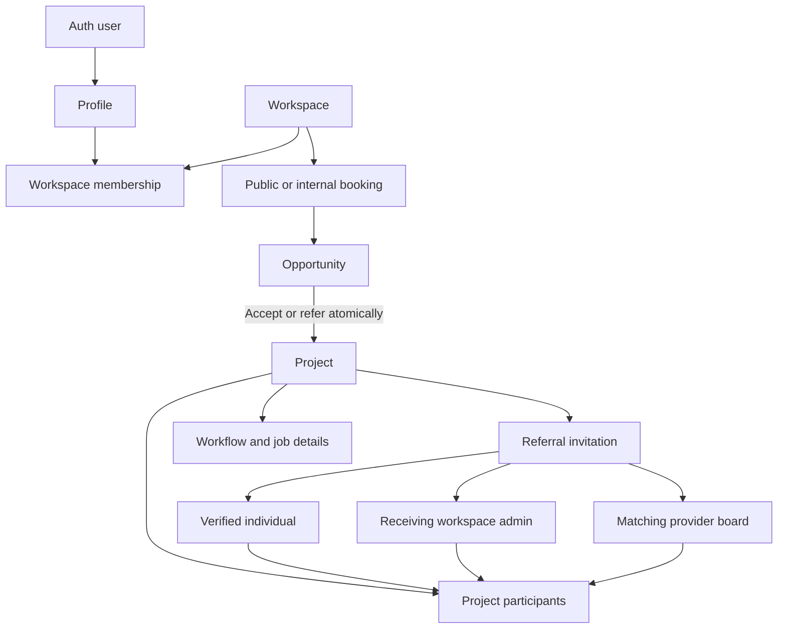

# Schema and access model

The deployed database has 36 public tables with Row Level Security and a private upload-capability table. Identity is separate from workspace membership. A person can be an internal user in one workspace and a referral participant in another.

| Layer | Tables | Purpose |
|---|---|---|
| Identity | `profiles` | One profile per Supabase Auth user; protected platform-admin flag |
| Companies and membership | `workspaces`, `workspace_members` | Company settings, unique booking key, internal/admin/referral membership and access state |
| Dispatch configuration | `services`, `workspace_services`, `workspace_locations`, `member_services`, `member_availability` | Catalog, selected services, ZIP coverage, verification, tier priority and availability |
| Intake | `customers`, `opportunities`, `opportunity_media`, `opportunity_offers` | Separate booking Opportunities, customer contact records, private media and expiring offers |
| Projects and access | `projects`, `project_members` | One accepted project per Opportunity; assignee, crew and referral participants |
| Referrals | `referral_invites`, `referral_payouts` | Unique expiring invitations, three target modes, claimed identity, agreed payout record |
| Workflow | `workflow_steps`, `project_steps`, `project_activity` | Seven configurable steps, per-project completion/data, status/step audit history |
| Job assessment | `claims`, `project_floors`, `project_rooms`, `moisture_readings`, `room_photos`, `room_materials`, `room_measurements`, `drying_plans` | Assessment, floor/room detail, drying and moisture records |
| Scope and administration | `service_packages`, `project_scope_items`, `project_expenses`, `contract_templates`, `project_contracts`, `project_files`, `project_emails`, `payments` | Scope prices, costs, contracts, file/email metadata and payment records |
| Notifications | `notifications` | Recipient-scoped alerts and read state |
| Private capabilities | `private.upload_tokens` | Expiring authorization to upload media; no direct client table access |

| Role | Allowed access |
|---|---|
| Platform admin | All workspaces and users; company creation and global management |
| Workspace admin | Own company settings/team/services/coverage; intake/projects/referrals/customers; payment records |
| Internal user | Own active workspace's intake/projects/customers and referral creation; own profile and availability |
| Referral participant | Claimed projects, authorized job records, own profile and notifications; no company-wide customer list or financial/contract records |
| Public customer | Service form configuration and booking submission via a workspace key; no dashboard/table access |

Accepting a referral does not move the project into another workspace or create another project. The receiving user is attached to the originating project, with referral membership in its workspace. Incoming workspace referrals remain visible in that receiving user's My Projects while they act in the receiving workspace.

An individual claim requires a confirmed matching Auth email (or matching confirmed phone for phone-only invitations). Workspace referrals require an admin of the named workspace. Open listings require active internal membership, matching services, and ZIP coverage. Project row locks and a unique partial index prevent competing claims. Closed projects cannot be newly referred.

Direct client writes to protected intake/project/referral workflow tables are revoked. Checked RPCs enforce ownership, recipient identity, status transitions and last-admin protection. Browser callers never receive a service-role/secret API key. Edge Functions normally query as the caller, preserving RLS; only account provisioning uses the privileged Auth API after referral creation has been authorized.

The supplied form selects one service, so this implementation retains one Opportunity to one Project. The old ERD's separate multi-service job-line layer, duplicate provider/service lookup names, customer participants and personal referral-code tables were not copied as redundant structures. `project_members` supplies user participation; customers remain contact records rather than dashboard accounts. Introduce a separate job-line table if a future booking form actually supports multiple independently accepted services.
